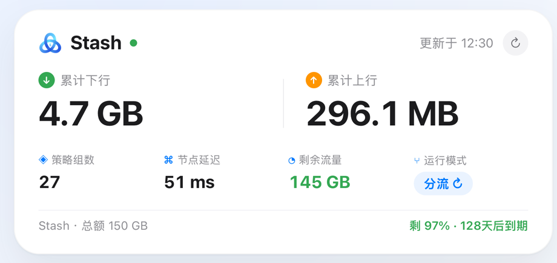
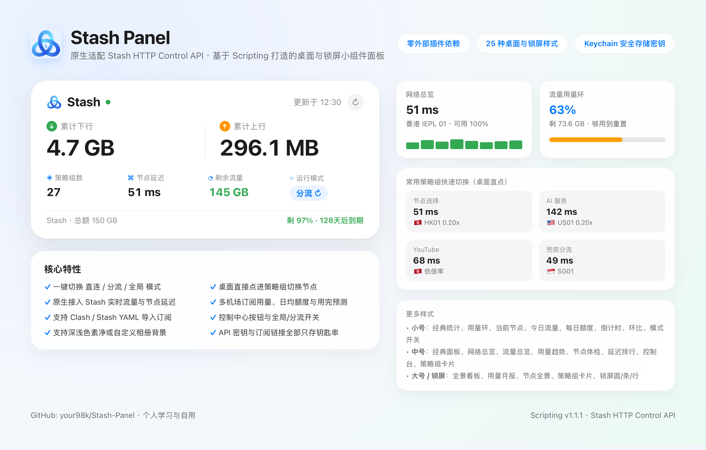

<div align="center">


# Stash-Panel

**自用及原创的 Stash 面板与小组件合集**
基于 **[Scripting](https://scripting.fun)** 与 **Stash HTTP Control API** 构建，持续收录各类桌面小组件、锁屏组件、节点测速与机场用量看板。

[](#收录面板)
[](https://scripting.fun)
[](https://stash.wiki)

</div>

---

## 收录面板

| 面板 | 效果预览 | 核心功能 | 安装包 |
| :--- | :---: | :--- | :---: |
| **[Stash 面板（Stash Panel）](panels/stash-panel/README.md)**<br>`v1.1.6` | <a href="panels/stash-panel/README.md"></a> | 25 种桌面与锁屏样式、一键切模式、桌面策略组选节点、实时累计流量、节点延迟折线与可用率、多机场订阅预测与控制中心开关 | [Raw 下载](https://github.com/your98k/Stash-Panel/raw/main/panels/stash-panel/dist/Stash_Panel.scripting)<br>[CDN 下载](https://cdn.jsdelivr.net/gh/your98k/Stash-Panel@main/panels/stash-panel/dist/Stash_Panel.scripting)<br>[查看详情](panels/stash-panel/README.md) |
| **[网络诊断雷达（Network Radar）](panels/network-radar/README.md)**<br>`v1.0.0` | <a href="panels/network-radar/README.md"></a> | 出口 IP 与风险参考评分、代理/直连延迟、12 项流媒体与 AI 网页可达性、当前出口节点实测归属、深浅色自适应 | [Raw 下载](https://github.com/your98k/Stash-Panel/raw/main/panels/network-radar/dist/Network_Radar.scripting)<br>[CDN 下载](https://cdn.jsdelivr.net/gh/your98k/Stash-Panel@main/panels/network-radar/dist/Network_Radar.scripting)<br>[查看详情](panels/network-radar/README.md) |

---

## 面板画廊预览

### 1. [Stash 面板（Stash Panel `v1.1.6`）](panels/stash-panel/README.md)

<a href="panels/stash-panel/README.md">
  
</a>

- **快速导入**：[直接下载 Raw](https://github.com/your98k/Stash-Panel/raw/main/panels/stash-panel/dist/Stash_Panel.scripting) · [jsDelivr CDN](https://cdn.jsdelivr.net/gh/your98k/Stash-Panel@main/panels/stash-panel/dist/Stash_Panel.scripting) · [完整说明与 25 种样式一览](panels/stash-panel/README.md)

### 2. [网络诊断雷达（Network Radar `v1.0.0`）](panels/network-radar/README.md)

<a href="panels/network-radar/README.md">
  
</a>

- **快速导入**：[直接下载 Raw](https://github.com/your98k/Stash-Panel/raw/main/panels/network-radar/dist/Network_Radar.scripting) · [jsDelivr CDN](https://cdn.jsdelivr.net/gh/your98k/Stash-Panel@main/panels/network-radar/dist/Network_Radar.scripting) · [完整说明](panels/network-radar/README.md)
- 只读体检工具：不切节点、不改模式、不写配置，默认无凭据。
- 出口节点取自 Stash `/connections` 的真实链路，服务的节点归属实测回填，不猜地区。

> 后续制作的新 Stash 面板将按独立目录存放在 `panels/` 下，并在本页同步展示预览图与下载直链。

---

## 仓库结构

```text
Stash-Panel/
├── README.md                     # 仓库总览、面板画廊预览与下载索引
└── panels/                       # 各个 Stash 面板独立目录
    └── stash-panel/              # Stash 面板（Stash Panel v1.1.6）
        ├── README.md             # 面板功能介绍、样式预览与配置教程
        ├── assets/               # 图标与效果预览图
        ├── dist/                 # 可直接导入 Scripting 的 .scripting 安装包
        ├── src/                  # TypeScript / TSX 源码
        ├── tests/                # 离线回归检查脚本
        └── package.json
```

---

## 通用安装步骤

1. **安装环境**：确保设备上已安装 **[Scripting](https://scripting.fun)** 与 **Stash**。
2. **开启外部控制**：打开 **Stash** →「设置」→「外部控制（External Access）」，开启服务（默认端口 `9090`，可按需设置 Secret 密钥）。
3. **导入面板**：点击上方表格或画廊中的下载链接获取 `.scripting` 文件，选择「用 **Scripting** 打开」即可导入。
4. **添加组件**：在 iOS 主屏幕 / 锁屏添加 **Scripting** 小组件并选择对应脚本；详细参数与样式说明见各面板目录下的 `README.md`。

---

## 说明

- 原生调用 **Stash HTTP Control API**，不修改现有 Stash 分流规则与配置。
- 本仓库所有面板仅供个人学习、研究与自用。
