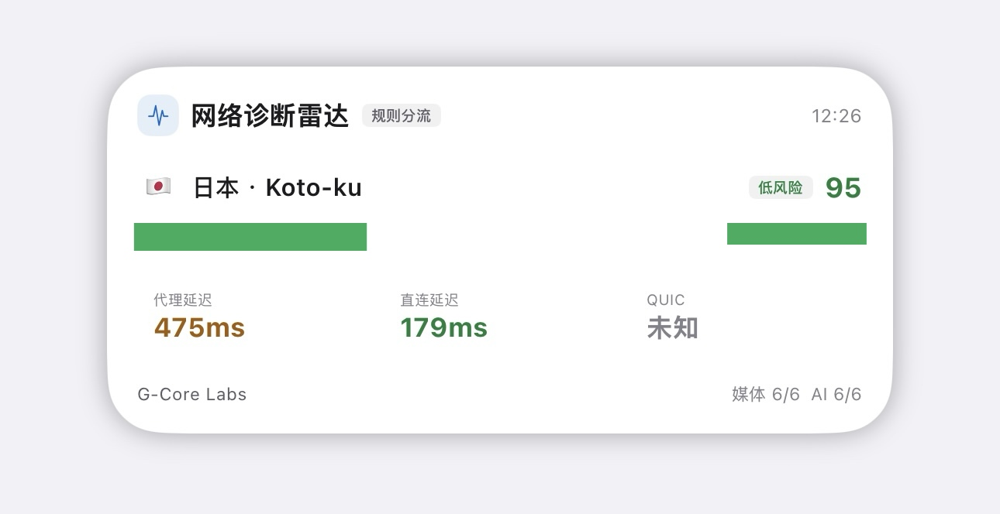
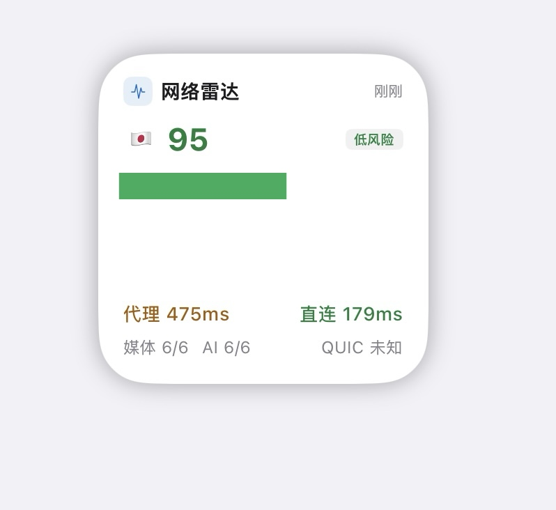

# Stash 网络诊断雷达 · Stash Network Radar

<div align="center">


**基于 Scripting 的 Stash 网络体检小组件**

出口 IP · IP 风险参考评分 · 代理/直连延迟 · 12 项流媒体与 AI 网页可达性 · 当前出口节点，一张图看完。

[](../../tree/main/panels/network-radar)
[](https://scripting.fun)
[](https://stash.wiki)

</div>

---

## 效果预览

<table>
<tr>
<td width="62%" valign="top"></td>
<td width="38%" valign="top">
<br />

</td>
</tr>
</table>

> 以上均为真机截图（大号 / 中号 / 小号）。图中 IP、节点名与运营商已打码，评分为示意数据。

---

## 核心特性

- **开箱即用**：直接读取 Stash 原生外部控制接口（默认 `http://127.0.0.1:9090`），无需安装覆写，不改动任何分流规则。
- **真实出口节点，不猜**：
  - 读取 `/connections` 里每条连接的 `chains`（`[节点, 上层组 …]`）与 `metadata.host`；
  - 按累计流量选出**当前实际承载流量的节点**，并显示所属策略组与协议类型（WireGuard / Trojan / VLESS …）；
  - 没有代理连接时回退策略组链，并明确标注来源是「实测」还是「链路」。
- **服务归属可追溯**：每条流媒体 / AI 服务后面直接标出它这次实际走的节点，换节点后自动跟着变。
- **出口与延迟**：并发多源查询出口 IP（ip-api / ipwho.is / ipapi.is / ipinfo），自测海外与国内站点延迟，给出 ISP、ASN、属性类型（住宅 / 商业机房 / 移动网络）与 IP 风险参考评分。
- **12 项网页可达性**：Netflix、Disney+、Spotify、TikTok、YouTube、Prime 与 ChatGPT、Claude、Gemini、DeepSeek、Grok、Perplexity。
- **小 / 中 / 大三种尺寸**，深浅色自适应；**原生素净模式不画任何底色**，只用系统底衬，深色下不会出现两种黑。
- **为小组件渲染预算优化**：核心数据与 12 项探测分开缓存，命中缓存 1–2 秒出图，绝不硬卡 WidgetKit 超时。

---

## 关于「可达」的准确含义

这里的探测是**网页 HTTP 可达性**，不是解锁检测：

- `2xx / 3xx` 记为「可达」，`403 / 429 / 其他` 记为「受限」，无响应记为「失败」；
- 某个站点返回 200 **不代表**你的账号能看该地区的片库、能登录、能播放；
- 未做真实 STUN 与 QUIC 链路探测，所以 NAT 与 QUIC 一律显示「未知」，不编造结论；
- `/connections` 只含**当前活跃连接**，不含历史记录，界面已注明来源。

---

## 快速安装与使用

### 1. 导入 Scripting

1. 安装 [Scripting](https://scripting.fun) 与 [Stash](https://stash.wiki)。
2. 下载安装包：[Network_Radar.scripting](../../raw/main/panels/network-radar/dist/Network_Radar.scripting)（或 [jsDelivr CDN](https://cdn.jsdelivr.net/gh/your98k/Stash-Panel@main/panels/network-radar/dist/Network_Radar.scripting)）。
3. 选择「用 Scripting 打开」完成导入。

### 2. 连接 Stash（可选，但强烈建议）

1. Stash →「设置」→「外部控制」开启服务，记下端口与密钥（Secret）。
2. 在 Scripting 中运行「Stash 网络诊断雷达」→「Stash Clash API」：
   - 打开「启用只读 API」；
   - 填地址（默认 `127.0.0.1`）、端口（默认 `9090`）、Bearer secret；
   - 「观察策略组」可留空（自动选活跃连接里最常见的组），也可填精确组名。
3. 返回后点「重新读取」，确认显示「已连接」。

### 3. 添加小组件

1. 先在 App 里点一次「立即诊断」，让缓存就绪（会同时探测 12 个服务）。
2. 长按主屏 →「＋」→ Scripting → 选择尺寸 → 编辑小组件选择本脚本。
3. 想立刻刷新数据：打开 App 点「刷新小组件」或「立即诊断」。

---

## 隐私与安全

- 仅调用 **只读** 接口：`GET /configs`、`GET /proxies`、`GET /connections`，不会切换节点、修改模式或写入配置。
- 默认**不启用**任何 API、也不内置任何密钥；Bearer secret 只保存在本机 Scripting Storage，脚本内不含任何凭据。
- 仓库中的源码与安装包不含任何个人订阅、节点名、服务器地址或令牌。
- 仅读取本机回环地址；跨网络使用 HTTP 不加密，不建议把外部控制暴露到公网。

---

## 目录结构

```text
panels/network-radar/
├── assets/                       # 图标与预览图
├── dist/
│   └── Network_Radar.scripting   # 最新安装包（直接导入 Scripting）
├── src/
│   ├── script.json               # 脚本清单
│   ├── index.tsx                 # App 主界面
│   ├── widget.tsx                # 小组件入口（带渲染预算控制）
│   ├── diagnose.ts               # 网络探测：出口 IP / 延迟 / 服务可达性
│   ├── surge.ts                  # Stash Clash API：出口节点与服务归属
│   ├── net.ts                    # 带超时的请求、并发池、IP 工具
│   ├── store.ts                  # 快照与服务缓存
│   ├── types.ts                  # 数据结构
│   └── ui.tsx                    # 小 / 中 / 大三种布局
├── tests/                        # 离线回归（出口解析、缓存预算、深色模式）
└── README.md
```

---

## 常见问题

**Q：为什么 NAT 和 QUIC 一直显示未知？**
A：脚本没有做 STUN 打洞与真实 QUIC 握手验证，宁可显示未知也不给你错误结论。

**Q：为什么刚添加小组件时服务栏显示「尚未探测」？**
A：12 项探测很慢，会被 WidgetKit 的渲染预算杀掉。现在改为单独缓存 60 分钟，打开 App 点一次「立即诊断」就会补全。

**Q：出口节点显示的不是我选的节点？**
A：显示的是**当前实际承载流量**的节点（按 `/connections` 流量统计）。刚切换节点、还没有新连接时，它会沿用策略组链，并标注为「链路」。

**Q：能一键切节点或切模式吗？**
A：不能。本脚本是只读体检工具，不做任何写操作。需要交互切换请看同一仓库的 [Stash Panel](../stash-panel/README.md)。

---

## 说明

- 适配 Stash HTTP Control API；界面在 Scripting App 内运行。
- 仅供个人学习与自用。
- 预览图中的节点名、IP、评分为示意数据。
